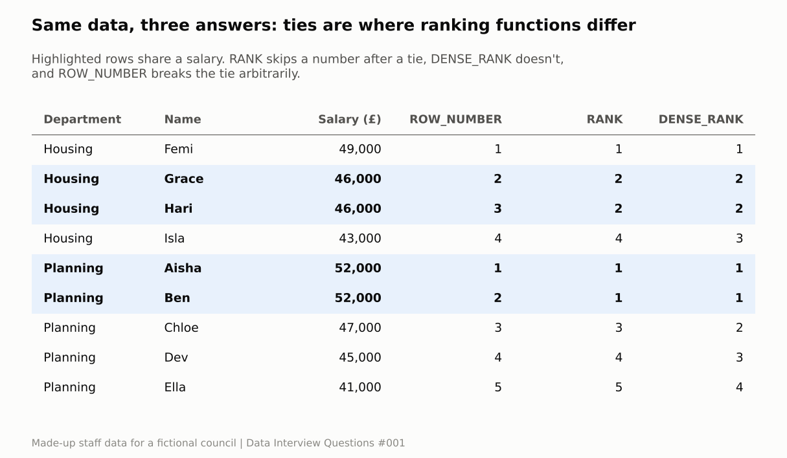

# Q-001: Find the highest-paid employee in each department. Then the top 3. What changes with ties?

<!-- NAV:START -->
> **Prep pages:** [Data Analyst (DA)](../../prep/data-analyst.md) · [Data Scientist (DS)](../../prep/data-scientist.md) · [Data Engineer (DE)](../../prep/data-engineer.md)  
> **More SQL:** ← (first) · (latest) → · [all questions](../../README.md#prep-by-interview-type)
<!-- NAV:END -->

**Roles:** Analyst · Scientist · Engineer · **Topic:** SQL (window functions, ranking) · **How often it's asked:** Tier 1. It's the most-reported SQL question in Exponent's data-engineering list (69 candidate answers), and "top N per group" questions fill the ranking section of Dataford's frequency-ranked top-50 SQL list.

---

## The 30-second answer

> "I'd rank rows *within* each department using a window function: `PARTITION BY department ORDER BY salary DESC`. Then I'd keep rank 1, or rank 3 or less for the top 3. The real decision is which ranking function to use, because they treat ties differently. `ROW_NUMBER` gives exactly one row per department and breaks ties arbitrarily. `RANK` keeps everyone tied for first, then skips numbers. `DENSE_RANK` keeps ties without skipping, which is usually what 'top 3 salaries' means. So I'd ask whether they want three *people* or three *salary levels*."

## The deeper answer (what makes it a strong answer)

- **Ask about ties before writing anything.** "Highest-paid employee" assumes there's only one. In real payroll data, there often isn't. Asking shows you think about the business meaning, not just syntax.
- **`PARTITION BY` is the key idea.** It restarts the ranking for each department, like a `GROUP BY` that keeps every row instead of collapsing them.
- **Why not `GROUP BY` + `MAX`?** `SELECT department, MAX(salary)` gives you the top *salary* but not *who* earns it. Getting the name back means joining to the table again, and that join quietly returns multiple rows on ties. The window version is clearer and handles ties on purpose.
- **Make `ROW_NUMBER` deterministic.** If you need exactly one row, add a tie-breaker, e.g. `ORDER BY salary DESC, start_date, employee_id`. Otherwise the result can change between runs.

## Example 1: public sector (the classic version, with ties)

**Scenario:** A (fictional) council's HR team asks: *"Who is the top earner in each department, and who are the top three salaries?"* Two Planning officers earn exactly the same.

**Data:** `staff(name, department, salary)`, 11 made-up rows. **Code:** [`example.py`](example.py)

```sql
SELECT department, name, salary,
       ROW_NUMBER() OVER w AS row_number,
       RANK()       OVER w AS rank,
       DENSE_RANK() OVER w AS dense_rank
FROM staff
WINDOW w AS (PARTITION BY department ORDER BY salary DESC);
```



**What it shows:**
- In **Planning**, Aisha and Ben both earn £52,000. `ROW_NUMBER = 1` returns **one** of them; `RANK = 1` returns **both**.
- After that tie, `RANK` jumps from 1 to **3** (Chloe), while `DENSE_RANK` gives Chloe **2**.
- "Top 3 salaries" with `DENSE_RANK <= 3` returns **4 people** in Housing (Grace and Hari share second place). `ROW_NUMBER <= 3` would silently drop Isla, who has the third-highest *salary*.

**Takeaway:** for "who earns the most?", ties are real people. Use `RANK` or `DENSE_RANK` so nobody is silently left out.

## Example 2: retail (same pattern, a different requirement, the opposite choice)

**Scenario:** A (fictional) retailer's weekly dashboard has a tile with **exactly three slots** per region: *"Top 3 products by revenue."* In the North, Gloves and Boots tie on £5,200 for third place.

**Data:** `sales(region, product, revenue, units)`, 9 made-up rows.

```sql
SELECT region, product, revenue, units,
       DENSE_RANK() OVER (PARTITION BY region ORDER BY revenue DESC) AS dense_rank,
       ROW_NUMBER() OVER (PARTITION BY region
                          ORDER BY revenue DESC, units DESC, product) AS tile_slot
FROM sales;
```

| region | product | revenue | units | dense_rank | tile_slot |
|---|---|---:|---:|---:|---:|
| North | Winter coat | 8,400 | 70 | 1 | 1 |
| North | Wool scarf | 6,100 | 305 | 2 | 2 |
| North | **Gloves** | **5,200** | **260** | **3** | **3** |
| North | **Boots** | **5,200** | **52** | **3** | **4** |
| North | Beanie | 3,000 | 200 | 4 | 5 |

**What it shows:**
- `DENSE_RANK <= 3` returns **4 North products**, which breaks a three-slot tile.
- `ROW_NUMBER` with an **explicit tie-breaker** (more units sold wins, then product name) returns exactly 3, and the third slot goes to **Gloves** (260 units vs 52) for a reason you can explain to the merchandising team.

**Takeaway:** the *business requirement* picks the function. "Don't leave anyone out" → `RANK` / `DENSE_RANK`. "Exactly N rows" → `ROW_NUMBER` plus a tie-breaker you'd be happy to defend. Never let the database break ties at random.

## Common wrong answers

1. **`ORDER BY salary DESC LIMIT 1`.** That gives the top earner in the *whole company*, not per department.
2. **`GROUP BY department` and selecting `name`.** Invalid SQL in most databases. In MySQL with lenient settings, it returns an arbitrary name.
3. **Using `ROW_NUMBER` without mentioning ties.** It's technically right, but it misses what the interviewer is really testing.
4. **Filtering on the window column in `WHERE` in the same query.** Window functions are calculated *after* `WHERE`, so wrap the query in a subquery or CTE, or use `QUALIFY` where it's supported (Snowflake, DuckDB, BigQuery, Databricks).

## Follow-ups they'll ask

- **"Return the second-highest salary per department."** Use `DENSE_RANK = 2`. With `RANK`, a department where two people tie for first has no rank 2 at all.
- **"What if a department has only one person?"** It still returns its one row for top-1 questions. For "second-highest", decide whether to return NULL or leave the department out, and say which.
- **"How would this perform on 100 million rows?"** The window needs data sorted by department and salary. An index on `(department, salary DESC)` helps, and in Spark the partition key drives the shuffle.
- **"Do it without window functions."** Use a correlated subquery: keep rows where the count of higher salaries in the same department is less than N. It's correct but slower, so mention that trade-off.

## Explain it to a non-technical person

> "Imagine every department running its own league table of salaries. I sort each table separately and take the top of each. The only tricky part is a tie for first place: do we name both people, or pick one? That's a business decision, so I'd check with you first."

## Related

- **Case file #001** (Data Explained) uses the same window-function idea with `AVG() OVER` for rolling averages: [Is A&E demand rising, or is it just Monday?](https://github.com/suryanaraynan/data-explained/tree/main/posts/2026-11-17-ae-mondays-rolling-average)
