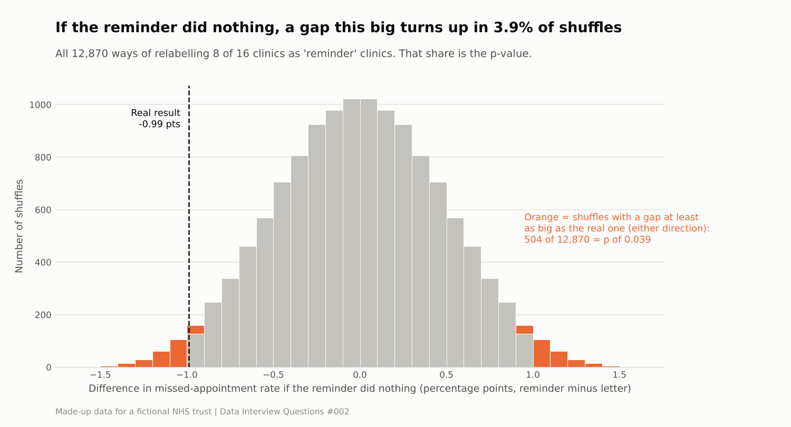

# Q-002: What is a p-value? Explain it to a non-technical person.

<!-- NAV:START -->
<!-- NAV:END -->

**Roles:** Analyst · Scientist · **Topic:** Statistics (hypothesis testing) · **How often it's asked:** Tier 1. It appears in both Exponent's data-science interview list (#6) and Interview Query's data-science question list; sources are in [`questions.json`](../../questions.json).

---

## The 30-second answer

> "A p-value answers one narrow question: if nothing real were going on, how often would I see a result at least as extreme as this one, just from random variation? A small p-value, say 0.03, means a gap this big would be unusual if there were no real effect, so I have some evidence against 'no effect'. What it doesn't tell me is the chance my idea is true, or how big the effect is. So I always report it next to the effect size and a confidence interval, and I fix the threshold and the number of tests before looking at the data."

## The deeper answer (what makes it a strong answer)

- **State the null hypothesis first.** A p-value only means something inside a specific "nothing is going on" world: no difference between groups, a fair coin. Name that world.
- **Get the direction of the probability right.** It's P(data this extreme | no effect), not P(no effect | data). The American Statistical Association's 2016 statement on p-values makes exactly this point: a p-value does not measure the probability that the hypothesis is true, and it does not measure the size or importance of an effect.
- **Why not just "significant or not"?** 0.049 and 0.051 are practically the same evidence. Report the effect and its confidence interval so people can judge whether the difference matters.
- **Know what breaks it.** Running many tests, peeking and stopping early, or picking the outcome after seeing the data all make small p-values easy to find. With a huge sample, a tiny and useless difference can still get a very small p-value.

## Example 1: NHS trust (the classic version: what the number literally means)

**Scenario:** A (fictional) NHS trust randomly picked 8 of its 16 outpatient clinics to trial a new text reminder. The outpatients manager asks: *"Missed appointments look lower in the reminder clinics. Is that real, or could it be luck?"*

**Data:** `clinics(clinic, group, did_not_attend_pct)`, 16 made-up rows. The edge case is a modest gap with small groups, where it's tempting to read too much into the p-value. **Code:** [`example.py`](example.py)

```python
observed = reminder_mean - control_mean                    # -0.99 percentage points
# Pretend the reminder did nothing: every split of 8 clinics vs 8 is equally likely.
for idx in itertools.combinations(range(16), 8):           # all 12,870 splits
    null_diffs[k] = x[mask].mean() - x[~mask].mean()
p_shuffle = (np.abs(null_diffs) >= abs(observed)).mean()   # two-sided p-value
welch = stats.ttest_ind(x[is_reminder], x[~is_reminder], equal_var=False)
```



**What it shows:**
- Missed appointments averaged **8.05%** in the usual-letter clinics and **7.06%** in the reminder clinics, a gap of **-0.99 percentage points**.
- Of the **12,870** ways to relabel 8 clinics as "reminder" clinics, **504** give a gap at least that big in either direction. 504 / 12,870 is the p-value: **0.0392**.
- Welch's t-test, the textbook shortcut, gives **0.0351**. Same idea, close answer.
- The 95% confidence interval runs from **-1.89 to -0.08** points. The reminder probably helps, but the effect could be almost nothing. The p-value alone hides that.

**Takeaway:** p = 0.039 means "if the reminder did nothing, a gap this big would come up about 4 times in 100". It does *not* mean "96% chance the reminder works".

## Example 2: energy supplier (the twist: nineteen tests, one "winner")

**Scenario:** A (fictional) energy supplier emails 5,000 customers per subject line to get smart meter bookings. It tests **19 new subject lines** against its usual one and asks: *"Which one should we roll out?"* The twist: every email was given the **same true booking rate (4.0%)**, so no subject line is really better.

**Data:** `emails(subject_line, sent, bookings)`, 20 made-up rows. Each line is compared with the control using a two-proportion z-test, then corrected for 19 tests with the Holm method.

```python
pvals = [proportions_ztest([b, bookings[0]], [n, n])[1] for b in bookings[1:]]
holm = multipletests(pvals, alpha=0.05, method="holm")[1]
```

| subject_line | bookings | booking_rate_pct | p_value | holm_adjusted_p |
|---|---:|---:|---:|---:|
| CONTROL: Book your smart meter | 186 | 3.72 | | |
| **Last chance: free smart meter** | **231** | **4.62** | **0.0244** | **0.463** |
| Free installation, no catch | 214 | 4.28 | 0.1530 | 1.000 |
| Book online in 2 minutes | 210 | 4.20 | 0.2185 | 1.000 |
| *(16 more, all p > 0.25)* | | | | |

**What it shows:**
- **1 of 19** subject lines gets p < 0.05 (**0.0244**), a 4.62% booking rate against 3.72%. It looks like a winner, but it's noise by construction.
- After the Holm correction its p-value is **0.463**, and **0 of 19** remain below 0.05.
- With 19 independent tests and no real effect, the chance of at least one p < 0.05 is **62.3%**. Sharing one control makes the tests move together, but in **2,000** simulated campaigns like this, **41.3%** still produced a false "winner".

**Takeaway:** a p-value is a promise about **one planned test**: "this would be rare if nothing were going on." Run many tests and rare things become expected. Fix the question and the number of tests in advance, correct for multiple comparisons, and report the effect size next to the p-value.

## Common wrong answers

1. **"It's the probability the null hypothesis is true."** It's calculated *assuming* the null is true, so it can't also be the probability of the null.
2. **"p = 0.03 means a 97% chance the result is real."** Same mistake, the other way round. That would need a prior and Bayes' theorem.
3. **"A small p-value means a big or important effect."** Example 1's interval reaches -0.08 points. With enough data, trivial differences get tiny p-values.
4. **"p > 0.05 proves there's no effect."** It means the data aren't surprising under "no effect", often because the sample is too small. Absence of evidence isn't evidence of absence.
5. **Ignoring how many tests were run.** Example 2 shows one in nineteen "wins" by chance alone.

## Follow-ups they'll ask

- **"Why 0.05?"** It's a convention, not a law of nature. The right threshold depends on the cost of a false positive versus a missed effect, and it should be set before seeing the data.
- **"What's the difference between a p-value and a confidence interval?"** The p-value tests one specific value (usually zero). The interval shows the range of effect sizes compatible with the data, which is usually more useful for a decision.
- **"One-sided or two-sided?"** Two-sided unless you'd genuinely ignore an effect in the other direction, decided in advance. Switching to one-sided after seeing the data halves the p-value and is a form of p-hacking.
- **"How would you handle testing many metrics or variants?"** Pre-register one primary metric, then use Bonferroni or Holm for strict control of false positives, or Benjamini-Hochberg when you're screening many options and can accept some false discoveries.

## Explain it to a non-technical person

> "Imagine a friend flips a coin and gets heads eight times in a row. You'd start to wonder whether it's a trick coin, because with a fair coin that only happens about 4 times in 1,000 tries. The p-value is that 'how surprising would this be if nothing funny were going on?' number. It tells you to be suspicious, but on its own it doesn't prove the coin is fake or tell you how badly it's weighted."
