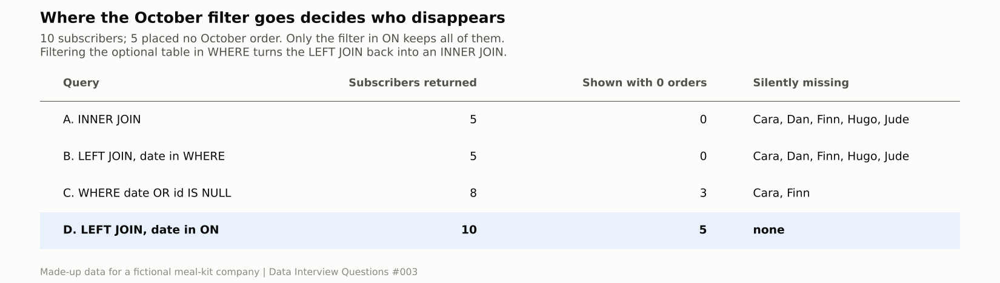

# Q-003: INNER JOIN vs LEFT JOIN: when do you use each, and what goes wrong with LEFT JOIN filters?

<!-- NAV:START -->
<!-- NAV:END -->

**Roles:** Analyst · Scientist · Engineer · **Topic:** SQL (joins, filters in ON vs WHERE) · **How often it's asked:** Tier 1. It appears in Dataford's frequency-ranked top-50 SQL list (#32), Interview Query's data-science question list (#49) and Exponent's data-science interview list (#19); sources are in [`questions.json`](../../questions.json).

---

## The 30-second answer

> "An INNER JOIN keeps only rows that match on both sides. A LEFT JOIN keeps every row from the left table, and fills the right side with NULLs where there's no match. So I use INNER when an unmatched row is meaningless for the question, and LEFT when the unmatched rows are part of the answer, like customers with zero orders. The classic mistake is filtering the right-hand table in the WHERE clause. Those NULL rows fail the filter, so the LEFT JOIN quietly becomes an INNER JOIN. The rule I follow: conditions on the optional table go in ON, conditions on the table I'm keeping go in WHERE."

## The deeper answer (what makes it a strong answer)

- **Ask what should happen to non-matches.** "Orders per customer" can mean "customers who ordered" or "every customer, including zeros". That decides the join type.
- **Know the order of operations.** The ON condition decides which right-hand rows attach to each left row. WHERE then filters the joined result. A NULL compared with anything is not true, so `WHERE o.order_date >= ...` throws away every unmatched row. MySQL's manual calls this *outer join simplification*: when the WHERE condition rejects NULLs, the optimiser converts the outer join to an inner join.
- **Why not LEFT JOIN everywhere, to be safe?** It isn't safer. It hides missing reference data that should fail loudly, and passes NULLs to people who don't expect them.
- **Count the right thing.** After a LEFT JOIN, `COUNT(*)` counts the NULL-padded row, so a customer with no orders shows 1. Use `COUNT(right_table.key)` and `COALESCE(SUM(...), 0)`.

## Example 1: subscriptions (the classic version: the filter in WHERE)

**Scenario:** A (fictional) meal-kit company's retention team asks: *"Show October orders and spend for every subscriber, including those who ordered nothing. They're our win-back list."*

**Data:** `subscribers(subscriber_id, name, plan)`, 10 made-up rows, and `orders(order_id, subscriber_id, order_date, amount)`, 12 rows. Dan, Hugo and Jude have never ordered; Cara and Finn ordered only in September. **Code:** [`example.py`](example.py)

```sql
-- B: the bug. The filter on the optional table sits in WHERE.
FROM subscribers s
LEFT JOIN orders o ON o.subscriber_id = s.subscriber_id
WHERE o.order_date >= DATE '2026-10-01' AND o.order_date < DATE '2026-11-01'

-- D: the fix. The same filter moves into ON.
SELECT s.subscriber_id, s.name,
       COUNT(o.order_id)          AS oct_orders,
       COALESCE(SUM(o.amount), 0) AS oct_spend
FROM subscribers s
LEFT JOIN orders o
       ON o.subscriber_id = s.subscriber_id
      AND o.order_date >= DATE '2026-10-01' AND o.order_date < DATE '2026-11-01'
GROUP BY s.subscriber_id, s.name;
```



**What it shows:**
- The INNER JOIN (A) and the LEFT JOIN with the date in WHERE (B) return the **same 5 subscribers**. The five people the team actually asked about, Cara, Dan, Finn, Hugo and Jude, are missing from both.
- The common "half fix", `WHERE (October) OR o.order_id IS NULL` (C), returns **8**. It rescues the three who never ordered, but still drops **Cara and Finn**, because they *did* match a September order and that row failed the date test.
- Moving the date into ON (D) returns **all 10**, with **5** on 0 orders. October revenue is **£257.00** in both A and D: the fix adds rows, not money.
- With `COUNT(*)` instead of `COUNT(o.order_id)`, each of the 5 zero-order subscribers would show **1** order.

**Takeaway:** if you need the non-matches, the filter on the optional table belongs in ON. In WHERE, it silently turns your LEFT JOIN into an INNER JOIN.

## Example 2: transport operator (the twist: a filter on the kept table)

**Scenario:** A (fictional) bus company's North depot manager asks: *"For every North route, how many faults were reported in November? And which routes had none?"* An analyst who has learned "filters go in ON" puts the depot filter there too.

**Data:** `routes(route_id, depot)`, 8 made-up rows (4 North, 4 South), and `faults(fault_id, route_id, reported_on)`, 11 rows, one logged with no route.

```sql
-- WRONG: depot filter in ON. It only stops matches; it doesn't remove routes.
LEFT JOIN faults f ON f.route_id = r.route_id AND <November> AND r.depot = 'North'

-- RIGHT: optional-table filter in ON, kept-table filter in WHERE.
LEFT JOIN faults f ON f.route_id = r.route_id AND <November>
WHERE r.depot = 'North'

-- Routes with no November faults (anti-join): IS NULL in WHERE is correct here.
WHERE r.depot = 'North' AND f.fault_id IS NULL
```

| query | rows | what it says about S1 | "fault-free" routes |
|---|---:|---|---|
| Depot filter in ON | 8 | **0 faults** (true count: **3**) | **N2, N4, S1, S2, S3, S4** |
| **Depot filter in WHERE** | **4** | not returned | **N2, N4** |

**What it shows:**
- With the depot in ON, all **8** routes come back, and South route S1 is reported with **0** November faults when it had **3**. The anti-join then calls **6** routes fault-free.
- With the depot in WHERE, you get the **4** North routes and **3** November faults in total. N2 and N4 had none (N2's only fault was in October).
- `NOT EXISTS` gives the same **N2, N4**. `NOT IN` returns **0 rows**, because the faults subquery contains a NULL `route_id`.

**Takeaway:** ON decides what *attaches*; WHERE decides what *survives*. Filter the optional table in ON, filter the kept table in WHERE, and use `WHERE right.key IS NULL` only when you want the non-matches.

## Common wrong answers

1. **"LEFT JOIN returns more rows, INNER returns fewer."** Usually, but the point is *which* rows. Example 1's buggy LEFT JOIN returned exactly the INNER JOIN's 5.
2. **Patching with `OR right.key IS NULL`.** It brings back left rows with no matches at all, but not ones whose matches all failed the filter (Cara and Finn).
3. **Putting every condition in ON "to be safe".** A condition on the left table in ON filters nothing (Example 2).
4. **Counting with `COUNT(*)` after a LEFT JOIN.** Zero becomes one.
5. **Ignoring duplicates on the right side.** A LEFT JOIN keeps every left row *at least* once, not exactly once. Several matches multiply rows and inflate sums.

## Follow-ups they'll ask

- **"For an INNER JOIN, does ON vs WHERE matter?"** Not for the result: non-matches are dropped either way. It matters only for outer joins.
- **"Find customers who never ordered."** LEFT JOIN and `WHERE o.order_id IS NULL`, or `NOT EXISTS`. Avoid `NOT IN` if the subquery column can be NULL: it returned 0 rows in Example 2.
- **"What's a FULL OUTER JOIN?"** It keeps unmatched rows from both sides, which is useful for reconciling two systems. MySQL 8.4 doesn't support it, so there you emulate it with a LEFT JOIN `UNION` a RIGHT JOIN.
- **"How do you check a join didn't change the grain?"** Compare `COUNT(*)` and `COUNT(DISTINCT key)` before and after. For a LEFT JOIN onto a lookup, the row count should equal the left table's.

## Explain it to a non-technical person

> "Think of a class register and a pile of homework. An inner join lists only the pupils who handed something in. A left join lists every pupil and leaves a blank where there's no homework. The common mistake is saying 'only October's homework' at the wrong moment: it throws out the blank lines too, and the pupils you most wanted to chase disappear."
