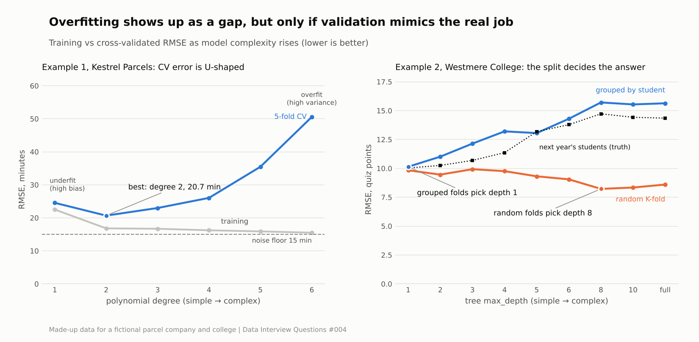

# Q-004: Explain the bias-variance trade-off. How do you diagnose overfitting?

<!-- NAV:START -->
<!-- NAV:END -->

**Roles:** Scientist · **Topic:** Machine learning (model complexity, validation) · **How often it's asked:** Tier 1. It appears in Exponent's data-science interview list (#38–39) and Interview Query's data-science question list (#39); sources are in [`questions.json`](../../questions.json).

---

## The 30-second answer

> "A model's error on new data comes from three places: bias, variance and noise. Bias is being wrong in a consistent way because the model is too simple, like fitting a straight line to a curve. Variance is being unstable, because the model is flexible enough to memorise the quirks of the particular training sample. Making a model more complex usually lowers bias and raises variance, so you look for the point in between. I diagnose overfitting by comparing training error with validation error: if training error is low and validation error is much higher, the model is overfitting. If both are high, it's underfitting. The judgement call is the validation split itself. It has to look like the real job, otherwise the diagnosis is wrong."

## The deeper answer (what makes it a strong answer)

- **Ask what the model will be used on.** Next month's data, new customers, a new region? That decides how to split for validation: random, by time, or by group. A random split is only honest when every row is independent.
- **Name the decomposition.** For squared error, expected test error = bias² + variance + irreducible noise. You can't beat the noise, so the aim is the lowest *sum* of bias² and variance, not zero of either.
- **Diagnose with curves, not one number.** A validation curve (error against model complexity) shows where the validation error bottoms out. A learning curve (error against training-set size) shows whether more data would help: a big gap that narrows as data grows means variance; two high curves that have flattened out mean bias, and more data won't fix it.
- **Know the fixes for each side.** Too much variance: simpler model, regularisation, more data, bagging. Too much bias: more flexible model, better features.
- **Keep a final test set out of the tuning.** The best validation score is slightly optimistic once you've chosen by it.

## Example 1: logistics (the classic version: the U-shaped curve)

**Scenario:** A (fictional) parcel company, Kestrel Parcels, wants to predict how long a van route takes from its number of stops, so planners stop overloading drivers. How flexible should the model be?

**Data:** `routes(route, stops, minutes)`, 20 made-up routes. Each extra stop adds time, but less once drops cluster on the same streets, plus 15 minutes of random traffic and doorstep luck no model can predict. **Code:** [`example.py`](example.py)

```python
model = make_pipeline(MinMaxScaler((-1, 1)),
                      PolynomialFeatures(degree, include_bias=False), LinearRegression())
res = cross_validate(model, X, y, cv=KFold(5, shuffle=True, random_state=0),
                     scoring="neg_root_mean_squared_error", return_train_score=True)
```



| degree | training RMSE | 5-fold CV RMSE | gap |
|---:|---:|---:|---:|
| 1 (straight line) | 22.5 | 24.5 | 2.0 |
| **2** | **16.8** | **20.7** | **3.9** |
| 4 | 16.2 | 26.0 | 9.8 |
| 6 | 15.5 | 50.6 | 35.0 |

**What it shows:**
- Training error only goes down as the degree rises, from **22.5** to **15.5** minutes. On its own it would always tell you to pick the most complex model.
- Cross-validated error is U-shaped. It is lowest at **degree 2 (20.7 minutes)** and climbs to **50.6** at degree 6, where the gap between training and validation is **35.0** minutes. That gap is overfitting.
- The straight line underfits: both errors are high (**22.5** and **24.5**) with a small gap, well above the **15**-minute noise floor.
- Because the data is simulated, we can measure bias and variance directly by refitting on 300 fresh sets of 20 routes. Bias² falls from **434.3** (degree 1) to **19.0** (degree 2) to **10.5** (degree 6), but variance jumps from **49.3** at degree 2 to **2,467.8** at degree 6. Expected RMSE is **27.2**, **17.1** and **52.0** minutes.

**Takeaway:** for Kestrel, a gentle curve (degree 2) is the sweet spot. The overfit model looked best on the data it had seen and worst on the routes it hadn't.

## Example 2: education (the twist: the split hides the overfitting)

**Scenario:** A (fictional) college, Westmere College, wants to predict weekly quiz scores from prior GCSE grades, attendance and study hours, so it can flag *next year's* students for support. Each student appears six times, and each has an underlying ability the features don't capture.

**Data:** `quizzes(student_id, week, prior_gcse, attendance_pct, study_hours, quiz_score)`, 240 made-up rows (40 students × 6 weeks), plus a fresh cohort of 40 new students to check the answer against.

```python
# Random folds: the same student's weeks land in both training and validation.
cross_validate(tree, X, y, cv=KFold(5, shuffle=True, random_state=0), ...)
# Grouped folds: each student is entirely in training or entirely in validation.
cross_validate(tree, X, y, cv=GroupKFold(5), groups=df["student_id"], ...)
```

| tree max_depth | training | random K-fold | grouped K-fold | new students |
|---:|---:|---:|---:|---:|
| **1** | 9.8 | 9.8 | **10.1** | **10.0** |
| 4 | 7.1 | 9.8 | 13.2 | 11.4 |
| **8** | 2.4 | **8.2** | 15.7 | **14.7** |
| full | 0.8 | 8.6 | 15.6 | 14.3 |

**What it shows:**
- Random K-fold picks **depth 8**, with an RMSE of **8.2** quiz points. On genuinely new students that model scores **14.7**, worse than predicting the average for everyone (**12.1**).
- A student's prior grades and attendance are the same every week, so they act like a fingerprint. The deep tree memorises each student's hidden ability from their other weeks, and random folds reward that.
- Grouped folds pick **depth 1**, with **10.1**. On new students it scores **10.0**: grouped CV told the truth and random CV did not.
- The training-versus-validation gap still exists with random folds (**2.4** vs **8.2** at depth 8), but it badly understates the real gap (**2.4** vs **14.7**).

**Takeaway:** overfitting is a gap between training error and error on the data you will actually predict, so the validation split has to copy the real job: group by entity, split by time, or hold out a site. Get it wrong and you'll pick the overfit model with confidence.

## Common wrong answers

1. **"Bias is prejudice in the data."** That's a different sense of "bias" (fairness, sampling). In this question bias is a systematic error from the model being too simple.
2. **"Overfitting is when training accuracy is high."** High training accuracy is fine if validation accuracy is close to it. The signal is the *gap*, or validation error rising as complexity rises.
3. **"Use random K-fold cross-validation."** Not when rows are grouped or ordered in time. Example 2's random folds picked the worst model.
4. **"More data fixes everything."** More data reduces variance. It does nothing for a model that's too simple: Kestrel's straight line stays wrong however many routes you add.

## Follow-ups they'll ask

- **"How does regularisation fit in?"** L1/L2 penalties, depth limits and dropout trade a little more bias for a lot less variance. You tune the strength with cross-validation, like the degree in Example 1.
- **"How do bagging and boosting relate to this?"** Bagging (random forests) averages many high-variance models to cut variance. Boosting adds many weak, high-bias models in sequence to cut bias, so it needs early stopping to avoid overfitting.
- **"What if the data is a time series?"** Validate forward in time, for example with scikit-learn's `TimeSeriesSplit`, so the model never trains on the future it is predicting.

## Explain it to a non-technical person

> "Imagine revising for an exam. If you only learn one rule of thumb, you'll get lots of questions wrong in the same way: that's bias. If you memorise last year's paper word for word, you'll ace that paper and struggle on the new one: that's variance. The fix is to practise on papers you haven't seen, and to make sure they really are new, not last year's paper with the questions shuffled."
